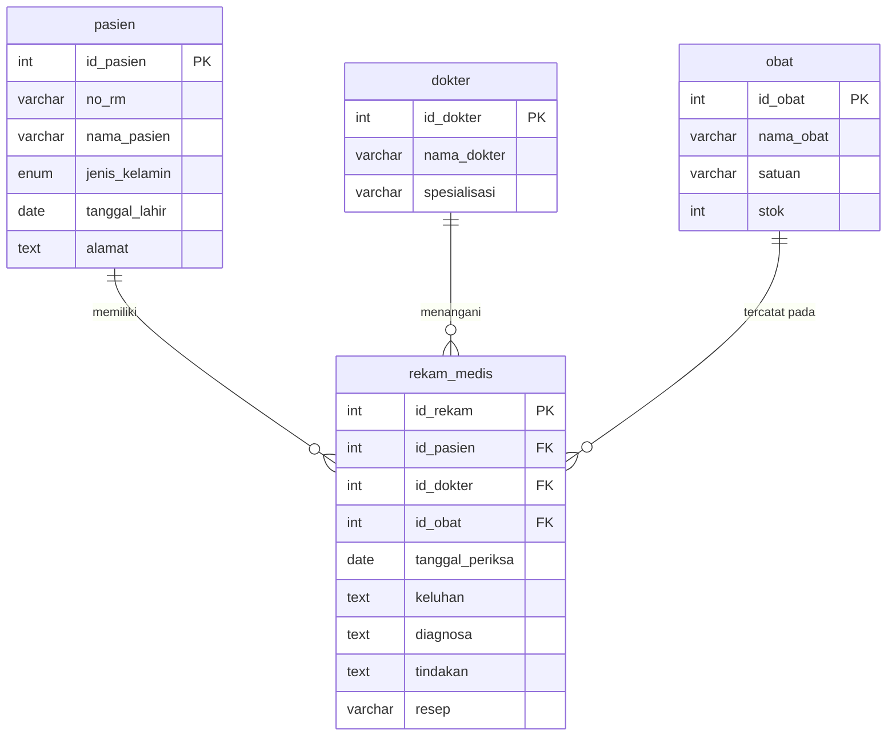

# Dokumentasi Proyek — Aplikasi Rekam Medis Sederhana

Uji Kompetensi Pemrograman Web, Semester Gasal — Konsentrasi Keahlian Rekayasa Perangkat Lunak (RPL), Kelas XII, SMK Negeri 3 Tuban.
Teknologi: HTML, CSS, PHP, MySQL/MariaDB. Seluruh data adalah data fiktif untuk pembelajaran.

> Catatan menjalankan aplikasi: salin folder `rekam_medis` ke server (XAMPP `htdocs` / folder proyek code server),
> sesuaikan `config.php` bila user/password database berbeda, lalu buka **`setup.php`** sekali untuk membuat
> database otomatis (atau import `db_rekam_medis.sql` lewat phpMyAdmin). Setelah itu buka `index.php`.

---

## 1. Struktur Folder

```
rekam_medis/
├── index.php            -> Dashboard (COUNT, riwayat terbaru, grafik per dokter, stok menipis)
├── config.php           -> Pengaturan koneksi database (host, user, password, nama db)
├── koneksi.php          -> Koneksi database + fungsi bantu (flash, format tanggal, umur)
├── setup.php            -> Pembuat database otomatis dari db_rekam_medis.sql
├── pasien.php           -> Daftar pasien (+ pencarian)
├── pasien_tambah.php / pasien_edit.php / pasien_hapus.php / pasien_detail.php
├── dokter.php           -> Daftar dokter (+ pencarian)
├── dokter_tambah.php / dokter_edit.php / dokter_hapus.php
├── obat.php             -> Daftar obat (+ pencarian, status stok)
├── obat_tambah.php / obat_edit.php / obat_hapus.php
├── rekam_medis.php      -> Riwayat pemeriksaan (SQL JOIN)
├── rekam_tambah.php     -> Form rekam medis (dropdown pasien, dokter, obat dari database)
├── rekam_edit.php / rekam_detail.php / rekam_hapus.php
├── rekam_cetak.php      -> Laporan riwayat siap cetak / simpan PDF
├── db_rekam_medis.sql   -> Database: 4 tabel, PK, FK, relasi, data uji fiktif
├── DOKUMENTASI.md       -> Dokumen ini (ERD, jawaban analisis, tabel pengujian)
├── includes/header.php  -> Template atas + sidebar navigasi
├── includes/footer.php  -> Template bawah
└── assets/css/style.css -> Tampilan (tema teal modern, responsif, ramah cetak)
```

## 2. Rancangan Database (`db_rekam_medis`)

| Tabel | Primary Key | Field lain |
|---|---|---|
| `pasien` | `id_pasien` INT Auto Increment | `no_rm` VARCHAR(20) unik, `nama_pasien` VARCHAR(100), `jenis_kelamin` ENUM('L','P'), `tanggal_lahir` DATE, `alamat` TEXT |
| `dokter` | `id_dokter` INT Auto Increment | `nama_dokter` VARCHAR(100), `spesialisasi` VARCHAR(50) |
| `obat` | `id_obat` INT Auto Increment | `nama_obat` VARCHAR(100), `satuan` VARCHAR(30), `stok` INT |
| `rekam_medis` | `id_rekam` INT Auto Increment | `id_pasien` FK, `id_dokter` FK, `id_obat` FK, `tanggal_periksa` DATE, `keluhan` TEXT, `diagnosa` TEXT, `tindakan` TEXT, `resep` VARCHAR(100) |

**Foreign Key pada `rekam_medis`:** `id_pasien → pasien.id_pasien`, `id_dokter → dokter.id_dokter`,
`id_obat → obat.id_obat`, dengan `ON DELETE RESTRICT` (data induk yang sudah terpakai tidak dapat dihapus)
dan `ON UPDATE CASCADE`. Tipe data PK dan FK sama-sama INT sehingga relasi valid.

## 3. ERD (Entity Relationship Diagram)



| Relasi | Kardinalitas | Keterangan |
|---|---|---|
| pasien → rekam_medis | 1 : N | Satu pasien dapat memiliki banyak catatan pemeriksaan |
| dokter → rekam_medis | 1 : N | Satu dokter dapat menangani banyak pemeriksaan |
| obat → rekam_medis | 1 : N | Satu obat dapat tercatat pada banyak pemeriksaan |

Tabel `rekam_medis` adalah tabel transaksi yang menghubungkan tiga tabel master.

## 4. Jawaban Pertanyaan Analisis (Bagian H LKPD)

**1. Apa yang dimaksud dengan Primary Key? Sebutkan field yang menjadi PK pada masing-masing tabel.**
Primary Key adalah field yang menjadi identitas unik setiap baris data pada sebuah tabel; nilainya tidak boleh sama/duplikat dan tidak boleh kosong (NOT NULL). PK pada aplikasi ini: `pasien.id_pasien`, `dokter.id_dokter`, `obat.id_obat`, dan `rekam_medis.id_rekam` — semuanya INT dengan Auto Increment.

**2. Apa fungsi Foreign Key pada tabel rekam_medis?**
Foreign Key berfungsi menghubungkan tabel rekam_medis dengan tabel induknya (pasien, dokter, obat) dan menjaga integritas referensial: nilai `id_pasien`, `id_dokter`, dan `id_obat` yang disimpan harus benar-benar ada pada tabel induknya masing-masing.

**3. Mengapa tabel rekam_medis membutuhkan relasi dengan tabel pasien, dokter, dan obat?**
Karena satu catatan pemeriksaan selalu melibatkan satu pasien yang diperiksa, satu dokter yang menangani, dan satu obat yang diresepkan. Dengan relasi, aplikasi cukup menyimpan ID-nya saja, sedangkan nama pasien, dokter, dan obat diambil dari tabel induk saat ditampilkan.

**4. Apa perbedaan SQL JOIN dengan menampilkan data dari satu tabel saja?**
Menampilkan satu tabel hanya menghasilkan data dari tabel itu saja (pada rekam_medis hanya tampak angka ID pasien/dokter/obat). SQL JOIN menggabungkan beberapa tabel yang berelasi dalam satu query, sehingga nama pasien, nama dokter, dan nama obat dapat tampil bersamaan dengan data pemeriksaan dan mudah dipahami pengguna.

**5. Apa yang terjadi jika id_pasien yang dimasukkan ke rekam_medis tidak tersedia pada tabel pasien?**
Penyimpanan akan **ditolak oleh database** dengan error foreign key constraint (integritas referensial dilanggar), karena FK `id_pasien` pada rekam_medis harus mengacu pada `id_pasien` yang benar-benar ada di tabel pasien. Itulah sebabnya form rekam medis menggunakan dropdown dari database, sehingga ID yang dipilih selalu valid.

**6. Mengapa data pasien, dokter, dan obat sebaiknya dikelola pada tabel terpisah?**
Agar tidak terjadi pengulangan data (redundansi) dan inkonsistensi. Jika nama pasien/dokter/obat ditulis ulang di setiap catatan pemeriksaan, satu kesalahan ketik atau satu perubahan nama harus diperbaiki di banyak tempat. Dengan tabel terpisah, data cukup disimpan dan diperbarui satu kali, lalu dihubungkan lewat ID.

## 5. Tabel Pengujian (Bagian G LKPD)

| No | Fitur | Hasil yang Diharapkan | Status |
|---|---|---|---|
| 1 | Tambah pasien | Data pasien tersimpan | ☑ Berhasil |
| 2 | Edit dokter | Perubahan data tersimpan | ☑ Berhasil |
| 3 | Hapus obat | Data terhapus sesuai aturan relasi (obat yang sudah dipakai di rekam medis tidak dapat dihapus) | ☑ Berhasil |
| 4 | Tambah rekam medis | Data tersimpan dengan FK valid | ☑ Berhasil |
| 5 | Dropdown relasi | Pilihan pasien, dokter, obat berasal dari database | ☑ Berhasil |
| 6 | JOIN riwayat | Nama pasien, dokter, dan obat tampil benar | ☑ Berhasil |
| 7 | Dashboard | Jumlah data sesuai isi database (SQL `COUNT()`) | ☑ Berhasil |

## 6. Fitur Aplikasi

- **Dashboard** — 4 kartu statistik dari SQL `COUNT()`, grafik pemeriksaan per dokter (`COUNT` + `GROUP BY`), 5 riwayat terbaru, dan daftar stok obat menipis/habis.
- **CRUD lengkap** — pasien, dokter, obat, dan rekam medis (tambah, tampil, edit, hapus) dengan pesan berhasil/gagal yang jelas (flash message).
- **Dropdown relasi** — form rekam medis memilih pasien, dokter, dan obat langsung dari database.
- **SQL JOIN** — riwayat pemeriksaan dan detail pasien menampilkan nama pasien, dokter, dan obat, bukan sekadar angka ID.
- **Validasi input** — field wajib, nomor RM unik, tanggal tidak boleh melebihi hari ini, stok tidak boleh negatif; semua query memakai *prepared statement* (aman dari SQL injection).
- **Pencarian** pada daftar pasien, dokter, obat, dan riwayat; **laporan riwayat siap cetak** (rekam_cetak.php).
- **Setup otomatis** — `setup.php` membuat database, tabel, relasi, dan data uji tanpa phpMyAdmin.

## 7. Refleksi (Bagian K LKPD — sesuaikan dengan pengalaman pribadi)

- Bagian pekerjaan yang paling mudah: membuat tabel dan CRUD data master (pasien, dokter, obat).
- Bagian pekerjaan yang paling sulit: menyusun relasi FK dan query JOIN pada riwayat pemeriksaan.
- Kesalahan yang ditemukan dan cara memperbaikinya: membaca pesan error database (misalnya pelanggaran FK saat menghapus data induk) lalu menyesuaikan aturan relasi dan pesan aplikasi.
- Kompetensi yang sudah dikuasai: perancangan database relasional (PK, FK, ERD), CRUD PHP–MySQL, dropdown relasi, SQL JOIN, dan fungsi agregat.
